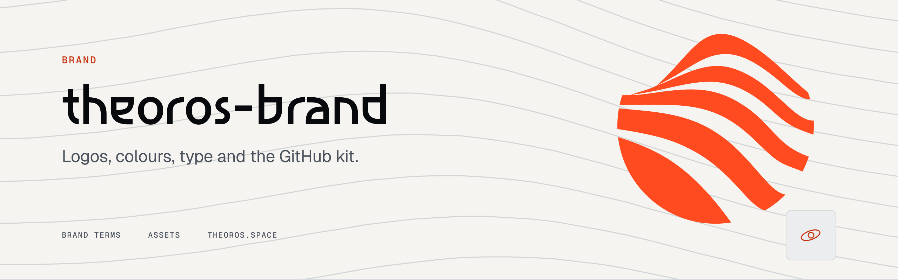
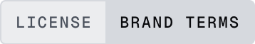
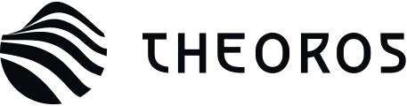
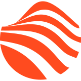
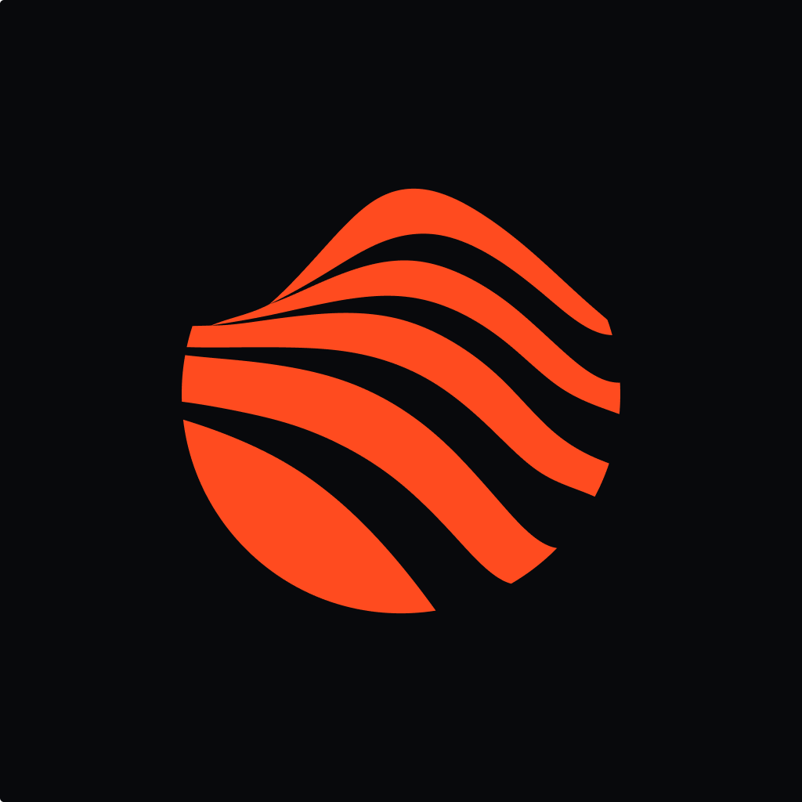
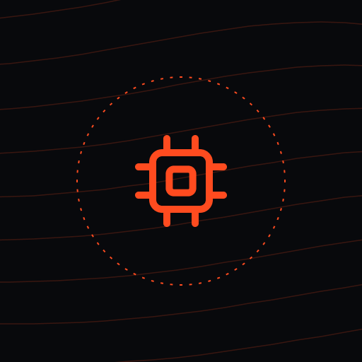
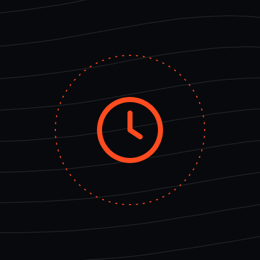
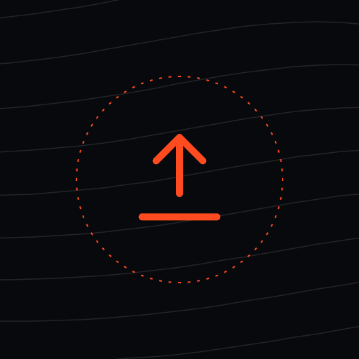
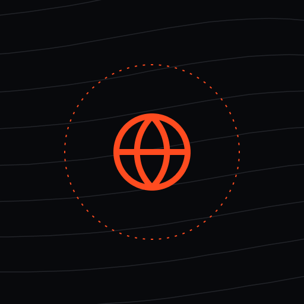

<picture>
  <source media="(prefers-color-scheme: dark)" srcset="https://raw.githubusercontent.com/theoros-space/theoros-brand/main/github/banners/brand-dark.png">
  <source media="(prefers-color-scheme: light)" srcset="https://raw.githubusercontent.com/theoros-space/theoros-brand/main/github/banners/brand-light.png">
  
</picture>

<a href="LICENSE"><picture><source media="(prefers-color-scheme: dark)" srcset="https://raw.githubusercontent.com/theoros-space/theoros-brand/main/github/badges/license-brand-terms-dark.png"></picture></a>

## Overview

The Theoros identity: logo, colour, type and the ready-made assets used across
GitHub, documents and slides. Use these files as they are; do not redraw,
recolour or combine them with other marks.

## Logo

  <picture>
    <source media="(prefers-color-scheme: dark)" srcset="logo/svg/horizontal-paper.svg">
    
  </picture>
  &nbsp;&nbsp;&nbsp;
  

| Layout | Ink, for light backgrounds | Paper, for dark backgrounds | Signal, Infrared mark |
|---|---|---|---|
| Horizontal | [svg](logo/svg/horizontal-ink.svg) | [svg](logo/svg/horizontal-paper.svg) | [svg](logo/svg/horizontal-signal.svg) |
| Stacked | [svg](logo/svg/stacked-ink.svg) | [svg](logo/svg/stacked-paper.svg) | [svg](logo/svg/stacked-signal.svg) |
| Mark | [svg](logo/svg/mark-ink.svg) | [svg](logo/svg/mark-paper.svg) | [svg](logo/svg/mark-signal.svg) |
| Wordmark | [svg](logo/svg/wordmark-ink.svg) | [svg](logo/svg/wordmark-paper.svg) | [svg](logo/svg/wordmark-signal.svg) |

- Clear space: at least the height of the letter T on every side.
- Minimum size: mark 16 px, horizontal logo 96 px wide.
- Never stretch, rotate, outline, add effects or recolour outside these tones.

## Colour

| | Name | Hex | Use |
|:-:|---|---|---|
|  | Void | `#08090C` | Primary dark, text on light |
|  | Orbit | `#11151C` | Dark surfaces |
|  | Graphite | `#262B34` | Lines on dark |
|  | Slate | `#4A515C` | Secondary text |
|  | Lunar | `#8B929D` | Muted text |
|  | Haze | `#D6D9DE` | Lines on light |
|  | Frost | `#ECEDEF` | Light surfaces |
|  | Paper | `#F5F4F0` | Primary light |
|  | Infrared | `#FF4B1F` | Signature accent |
|  | Infrared Deep | `#C7330F` | Accent text on light |
|  | Ion | `#3E7BFA` | Data and links |
|  | Aurora | `#2FD39A` | Success, onboard status |

Machine-readable values: [`tokens/colors.json`](tokens/colors.json).
Print targets (CMYK): Void 33 25 0 95, Paper 0 0 2 4, Infrared 0 71 88 0.
Closest Pantone for Infrared: Orange 021 C; confirm with a printed swatch.

## Type

| Role | Typeface |
|---|---|
| Display and headings | Asimovian |
| Text and interface | Geist |
| Data, labels, code | Geist Mono |

Fonts are licensed by their authors and are not redistributed here.

## GitHub kit

Designed in the Theoros Brand Identity Figma file, page **GitHub**, from the
brand Library (semantic colour variables, text styles, logo set, Orbit Lines
and icons). Every banner, diagram, stat card and badge exists in a dark and a
light version; READMEs serve both with `<picture>`.

| Path | Contents | Size |
|---|---|---|
| [`github/avatar/`](github/avatar/) | Organisation avatar in four tones | 1024 x 1024 |
| [`github/profile/`](github/profile/) | Organisation profile banner | 2560 x 960 |
| [`github/banners/`](github/banners/) | One header banner per repository | 2560 x 800 |
| [`github/diagrams/`](github/diagrams/) | Product flow, TheorosNet architecture, delivery lifecycle | 2560 wide |
| [`github/stats/`](github/stats/) | Key figure cards | 746 x 464 |
| [`github/badges/`](github/badges/) | Status, license, part, tier, target and build badges | 2x |
| [`github/social/`](github/social/) | Repository social previews | 1280 x 640 |
| [`github/release/`](github/release/) | Release note headers | 1280 x 320 |
| [`github/team/`](github/team/) | Team avatars | 512 x 512 |

  
  
  
  
  

## Source files

The master Figma files hold every application: stationery, deck, social,
print and the GitHub kit. Ask brand@theoros.space for access.

## License

See [LICENSE](LICENSE). The brand assets are not open source.

---

  <a href="https://github.com/theoros-space"><picture>
    <source media="(prefers-color-scheme: dark)" srcset="https://raw.githubusercontent.com/theoros-space/theoros-brand/main/logo/svg/mark-signal.svg">
    
  </picture></a>
   
  Theoros &nbsp;·&nbsp; Onboard AI for Earth observation &nbsp;·&nbsp; Baku and Helsinki &nbsp;·&nbsp; <a href="https://theoros.space">theoros.space</a>

